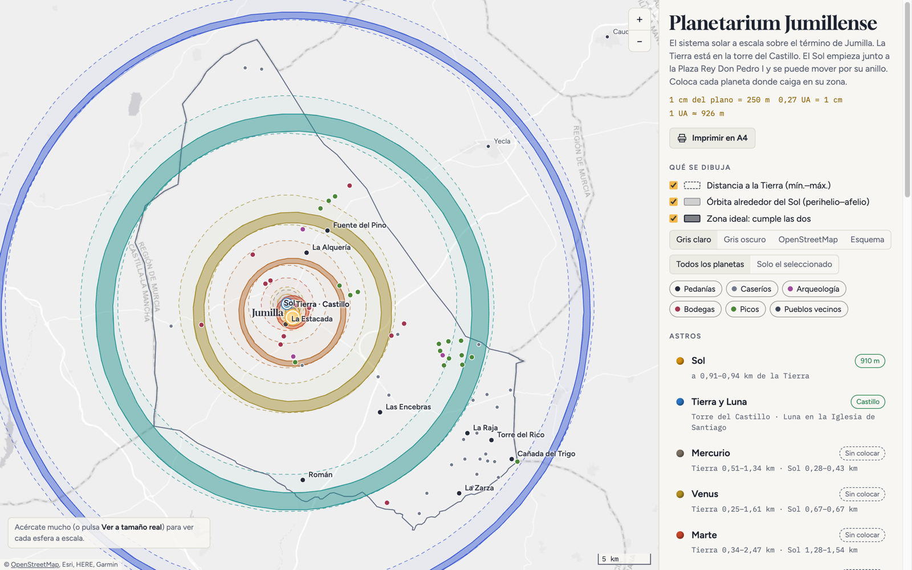

# Planetarium Jumillense

Mapa interactivo de una ruta turística que representa el sistema solar a escala
sobre el término municipal de Jumilla (Murcia). La Tierra está en la torre del
Castillo; cada planeta se coloca en la zona donde coinciden su distancia a la
Tierra y su órbita alrededor del Sol.

Web: https://planetarium-jumillense.vercel.app

## Escala

- 1 cm del plano 1/25.000 = 250 m
- 0,27 UA = 1 cm, así que 1 UA ≈ 926 m
- Con la misma escala, la Tierra mide 7,9 cm y el Sol 8,6 m

## Cómo funciona

Es una sola página estática (`index.html`) con [Leaflet](https://leafletjs.com).
El límite del término, las carreteras, pedanías, yacimientos, bodegas y picos
vienen de OpenStreetMap y van incluidos en la página. Los mapas de fondo en gris
son de Esri y OpenStreetMap.

Las ubicaciones que se eligen en el mapa se guardan solo en el navegador. Para
compartirlas, usa el botón «Copiar todas las ubicaciones».

## Datos

- Distancias a la Tierra: propuesta original del proyecto.
- Perihelio y afelio: NASA Planetary Fact Sheet.
- Cartografía: © colaboradores de OpenStreetMap (ODbL).

## Licencia

Una propuesta de [Carmen Marcos](https://carmen-marcos.art/).

El código está bajo la [licencia MIT](LICENSE), © 2026 Carmen Marcos y Rafael
Cordones. Los datos de OpenStreetMap incluidos en la página mantienen su propia
licencia (ODbL 1.0).
